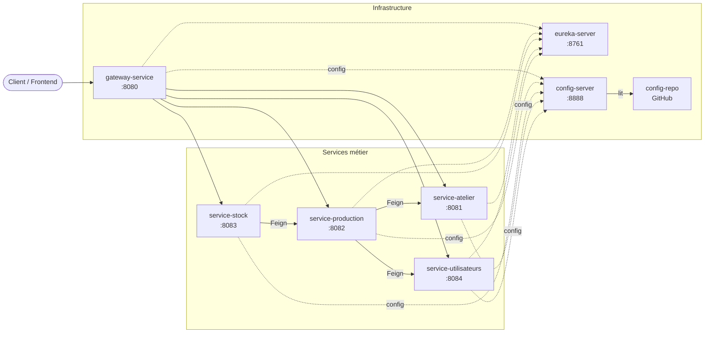
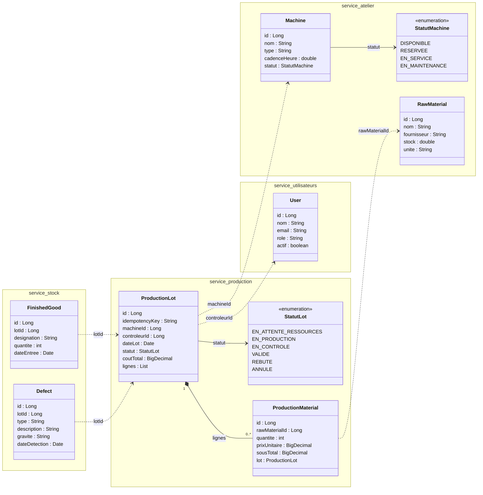

# Quali-Track

Application de **suivi de production en atelier**, construite en architecture microservices (Java 17, Spring Boot, Spring Cloud, Maven) dans le cadre du PFM de 5ème année (EMSI, cours J2EE avancé et Spring Boot).

Un **lot de production** est lancé sur une machine avec des matières premières, puis soumis à un contrôle qualité :

- **validé** : les produits conformes entrent en stock et la machine est libérée ;
- **rebuté** : les défauts sont enregistrés, et la machine est libérée ou placée en maintenance selon la cause du rejet ;
- **annulé** : si le lot n'a jamais démarré (ressources indisponibles), la machine et les matières réservées sont restituées.

Cycle de vie d'un lot : `EN_ATTENTE_RESSOURCES → EN_PRODUCTION → EN_CONTROLE → VALIDE / REBUTE`, ou `EN_ATTENTE_RESSOURCES → ANNULE`.

## Diagramme de classes

Chaque service possède ses propres entités. Les flèches en pointillés représentent les références entre services (par identifiant), sans préjuger du protocole de communication.


## Architecture

| Application | Rôle | Port |
|---|---|---|
| `gateway-service` | Point d'entrée unique, routage vers les services via Eureka | 8080 |
| `eureka-server` (`service-registry`) | Service Registry (découverte des services) | 8761 |
| `config-server` | Configuration centralisée depuis `config-repo` sur Git | 8888 |
| `service-atelier` | Machines et matières premières | 8081 |
| `service-utilisateurs` | Utilisateurs (contrôleurs qualité) | 8084 |


Flèches pleines : routage des requêtes par la Gateway, qui découvre les instances avec Eureka, et lecture de `config-repo` par le Config Server. Flèches en pointillés : enregistrement auprès d'Eureka et récupération de la configuration distante au démarrage.

## Lancer le projet

Depuis la racine du dépôt, démarrer les applications dans cet ordre, chacune dans un terminal séparé :

1. `mvn spring-boot:run -pl eureka-server`
2. `mvn spring-boot:run -pl config-server`
3. `mvn spring-boot:run -pl service-atelier`
4. `mvn spring-boot:run -pl service-utilisateurs`
5. `mvn spring-boot:run -pl gateway-service`

Le dashboard Eureka est disponible sur [http://localhost:8761](http://localhost:8761). Les services métier et la Gateway s'y enregistrent. La Gateway permet notamment d'appeler les services via la découverte :

- [http://localhost:8080/service-atelier/machines](http://localhost:8080/service-atelier/machines)
- [http://localhost:8080/service-utilisateurs/utilisateurs](http://localhost:8080/service-utilisateurs/utilisateurs)

Pour utiliser les routes statiques (`/machines/**`, `/matieres-premieres/**` et `/utilisateurs/**`) au lieu du préfixe de découverte, démarrer la Gateway avec le profil `statique` :

```shell
mvn spring-boot:run -pl gateway-service "-Dspring-boot.run.profiles=statique"
```

## Jalon V3 — Config Server

Le dossier `config-repo/` contient les propriétés globales partagées dans `application.properties` et les propriétés spécifiques à chaque service dans un fichier nommé d'après son application. Le fichier `gateway-service-statique.properties` contient la configuration des routes du profil `statique`.

Ordre de démarrage : Eureka (8761) → Config Server (8888) → `service-atelier` (8081) / `service-utilisateurs` (8084) → Gateway (8080). Le Config Server doit être démarré après Eureka, et avant les services et la Gateway, car ces trois clients récupèrent leur configuration distante au démarrage et échouent si le Config Server n'est pas disponible.

Eureka et Config Server conservent leur configuration localement : le Config Server est nécessaire pour fournir les configurations distantes, et Eureka doit démarrer indépendamment de ce serveur pour éviter une dépendance d'amorçage.

Avant de lancer le Config Server, `config-repo/` doit être commité et poussé sur la branche `main` de GitHub. Le serveur lit le dépôt GitHub configuré, pas le dossier local du dépôt.

URL de vérification des configurations :

- [http://localhost:8888/service-atelier/default](http://localhost:8888/service-atelier/default) — 2 `propertySources` : `service-atelier.properties`, puis `application.properties`.
- [http://localhost:8888/service-utilisateurs/default](http://localhost:8888/service-utilisateurs/default)
- [http://localhost:8888/gateway-service/default](http://localhost:8888/gateway-service/default)

Avec le discovery locator activé, la route Gateway vers les machines est [http://localhost:8080/service-atelier/machines](http://localhost:8080/service-atelier/machines). La route [http://localhost:8080/machines](http://localhost:8080/machines) correspond à la route statique, disponible avec le profil `statique`.

## V4 - Communication synchrone avec OpenFeign

### Objectif

Le jalon V4 met en place la communication synchronisée entre `service-production` et les services externes via OpenFeign. La création d'un lot passe par plusieurs validations métier avant la réservation de la machine et la consommation de stock : vérification du contrôleur, disponibilité de la machine, existence de la matière et stock suffisant, puis réservation machine + décrément stock dans `service-atelier`.

### Services impliqués

- `service-production` (8082) : orchestration du lot, validation des transitions et enrichissement des détails.
- `service-atelier` (8081) : machines et matières premières, réservation et décrément de stock.
- `service-utilisateurs` (8084) : profils utilisateurs et rôle `CONTROLEUR_QUALITE`.
- `service-stock` (8083) : création de `FinishedGood` et `Defect` selon le statut du lot.
- `gateway-service` (8080) : point d'entrée unique pour les appels de test via la collection Postman.
- `eureka-server` (8761) : découverte des services.
- `config-server` (8888) : configuration partagée.

### Règles métier

- Création contrôlée d'un lot : `POST /service-production/lots/new` avec en-tête `idempotencyKey` obligatoire et unique.
- Vérifications métier avant réservation : machine existante et `DISPONIBLE`, contrôleur actif avec rôle `CONTROLEUR_QUALITE`, matière existante et stock suffisant.
- Réservation de la machine et décrément de stock dans `service-atelier` exécutés dans une même création de lot ; si l'une des validations échoue, la transaction est interrompue avant réservation.
- Consultation enrichie : `GET /service-production/lots/{id}/detail` ajoute `machineNom`, `controleurNom`, `controleurEmail` et `rawMaterialNom` sur chaque ligne.
- Consultation enrichie : `GET /service-stock/finished-goods/{id}/detail` renvoie le statut du lot associé et les informations de stockage.
- Règle de création de `FinishedGood` : le lot associé doit être `VALIDE`.
- Règle de création de `Defect` : le lot associé doit être `EN_CONTROLE` ou `REBUTE`.
- Les transitions de statut validées par `ProductionLotService` sont : `EN_ATTENTE_RESSOURCES -> EN_PRODUCTION | ANNULE`, `EN_PRODUCTION -> EN_CONTROLE | ANNULE`, `EN_CONTROLE -> VALIDE | REBUTE`.

### Tableau des erreurs

| Code HTTP | Cause | Message observé |
|---|---|---|
| 400 | Validation métier ou payload invalide | `Contrôleur invalide`, `Machine indisponible`, `Stock insuffisant ...`, `Clé d’idempotence invalide`, `Opération déjà traitée` |
| 404 | Ressource absente ou service distant introuvable | `Ressource externe introuvable`, `ProductionLot not found: ...` |
| 409 | Conflit de données persistées | `A resource with conflicting data already exists` |
| 502 | Réponse HTTP non satisfaisante d'un service distant | `Erreur HTTP du service distant : [xxx]` |
| 503 | Service indisponible ou instance inaccessible | `Échec de communication avec un service` ou `Service ou instance indisponible` |

### Limite connue

La réservation de la machine et le décrément de stock sont traités en deux étapes séquentielles au sein de la création du lot. S'il y a un échec de la réservation après la première étape de validation, il n'y a pas de compensation automatique ; cette limite est traitée en V7 avec Kafka et transaction distribuée.

### Comment lancer la collection Postman

1. Importer le fichier `postman/Quali-Track - V4 OpenFeign.postman_collection.json` dans Postman.
2. Vérifier que les variables de collection sont bien définies : `baseUrl=http://localhost:8080`, `machineId=1`, `controleurId=3`, `adminId=1`, `rawMaterialId=1`, `lotKey`, `lotId`, `finishedGoodId`.
3. Démarrer les services dans l'ordre habituel : Eureka, Config Server, `service-atelier`, `service-utilisateurs`, `service-production`, `service-stock`, Gateway.
4. Exécuter la séquence dans l'ordre des requêtes du dossier `V4 - OpenFeign` ; la requête 6 réserve la machine et décrémente le stock de `rawMaterialId`.
5. Les données sont rechargées par le script `data.sql` au démarrage des services en mémoire. À chaque relance, redémarrer `service-atelier` (et `service-production` / `service-stock` si leurs données sont aussi en mémoire) pour repartir sur un seed propre.
6. Le dossier `Manuel - service indisponible` doit être exécuté manuellement, après arrêt de `service-atelier`, et exclu d'un run complet du Runner.

### Architecture V4



Flèches pleines : routage des requêtes via la Gateway. Flèches pointillées : découverte Eureka et lecture de configuration. Flèches Feign : `service-production` appelle `service-atelier` et `service-utilisateurs`; `service-stock` appelle `service-production` pour vérifier le statut des lots.

### Diagramme de classes V4



La description détaillée de la collection Postman V4 est dans le dossier `postman/Quali-Track - V4 OpenFeign.postman_collection.json`.

