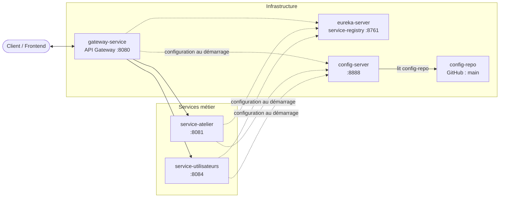

# Quali-Track

Application de **suivi de production en atelier**, construite en architecture microservices (Java 17, Spring Boot, Spring Cloud, Maven) dans le cadre du PFM de 5ème année (EMSI, cours J2EE avancé et Spring Boot).

Un **lot de production** est lancé sur une machine avec des matières premières, puis soumis à un contrôle qualité :

- **validé** : les produits conformes entrent en stock et la machine est libérée ;
- **rebuté** : les défauts sont enregistrés, et la machine est libérée ou placée en maintenance selon la cause du rejet ;
- **annulé** : si le lot n'a jamais démarré (ressources indisponibles), la machine et les matières réservées sont restituées.

Cycle de vie d'un lot : `EN_ATTENTE_RESSOURCES → EN_PRODUCTION → EN_CONTROLE → VALIDE / REBUTE`, ou `EN_ATTENTE_RESSOURCES → ANNULE`.

## Diagramme de classes

Chaque service possède ses propres entités. Les flèches en pointillés représentent les références entre services (par identifiant), sans préjuger du protocole de communication.


## Architecture

| Application | Rôle | Port |
|---|---|---|
| `gateway-service` | Point d'entrée unique, routage vers les services via Eureka | 8080 |
| `eureka-server` (`service-registry`) | Service Registry (découverte des services) | 8761 |
| `config-server` | Configuration centralisée depuis `config-repo` sur Git | 8888 |
| `service-atelier` | Machines et matières premières | 8081 |
| `service-utilisateurs` | Utilisateurs (contrôleurs qualité) | 8084 |



Flèches pleines : routage des requêtes par la Gateway, qui découvre les instances avec Eureka, et lecture de `config-repo` par le Config Server. Flèches en pointillés : enregistrement auprès d'Eureka et récupération de la configuration distante au démarrage.

## Lancer le projet

Depuis la racine du dépôt, démarrer les applications dans cet ordre, chacune dans un terminal séparé :

1. `mvn spring-boot:run -pl eureka-server`
2. `mvn spring-boot:run -pl config-server`
3. `mvn spring-boot:run -pl service-atelier`
4. `mvn spring-boot:run -pl service-utilisateurs`
5. `mvn spring-boot:run -pl gateway-service`

Le dashboard Eureka est disponible sur [http://localhost:8761](http://localhost:8761). Les services métier et la Gateway s'y enregistrent. La Gateway permet notamment d'appeler les services via la découverte :

- [http://localhost:8080/service-atelier/machines](http://localhost:8080/service-atelier/machines)
- [http://localhost:8080/service-utilisateurs/utilisateurs](http://localhost:8080/service-utilisateurs/utilisateurs)

Pour utiliser les routes statiques (`/machines/**`, `/matieres-premieres/**` et `/utilisateurs/**`) au lieu du préfixe de découverte, démarrer la Gateway avec le profil `statique` :

```shell
mvn spring-boot:run -pl gateway-service "-Dspring-boot.run.profiles=statique"
```

## Jalon V3 — Config Server

Le dossier `config-repo/` contient les propriétés globales partagées dans `application.properties` et les propriétés spécifiques à chaque service dans un fichier nommé d'après son application. Le fichier `gateway-service-statique.properties` contient la configuration des routes du profil `statique`.

Ordre de démarrage : Eureka (8761) → Config Server (8888) → `service-atelier` (8081) / `service-utilisateurs` (8084) → Gateway (8080). Le Config Server doit être démarré après Eureka, et avant les services et la Gateway, car ces trois clients récupèrent leur configuration distante au démarrage et échouent si le Config Server n'est pas disponible.

Eureka et Config Server conservent leur configuration localement : le Config Server est nécessaire pour fournir les configurations distantes, et Eureka doit démarrer indépendamment de ce serveur pour éviter une dépendance d'amorçage.

Avant de lancer le Config Server, `config-repo/` doit être commité et poussé sur la branche `main` de GitHub. Le serveur lit le dépôt GitHub configuré, pas le dossier local du dépôt.

URL de vérification des configurations :

- [http://localhost:8888/service-atelier/default](http://localhost:8888/service-atelier/default) — 2 `propertySources` : `service-atelier.properties`, puis `application.properties`.
- [http://localhost:8888/service-utilisateurs/default](http://localhost:8888/service-utilisateurs/default)
- [http://localhost:8888/gateway-service/default](http://localhost:8888/gateway-service/default)

Avec le discovery locator activé, la route Gateway vers les machines est [http://localhost:8080/service-atelier/machines](http://localhost:8080/service-atelier/machines). La route [http://localhost:8080/machines](http://localhost:8080/machines) correspond à la route statique, disponible avec le profil `statique`.
