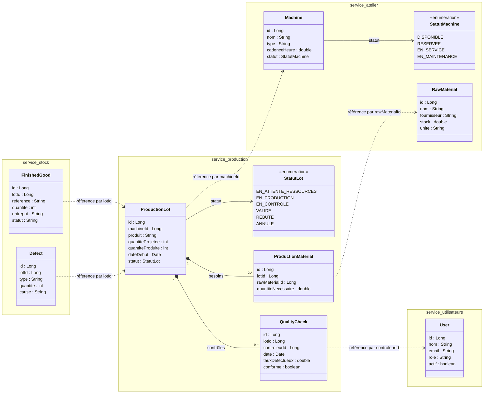
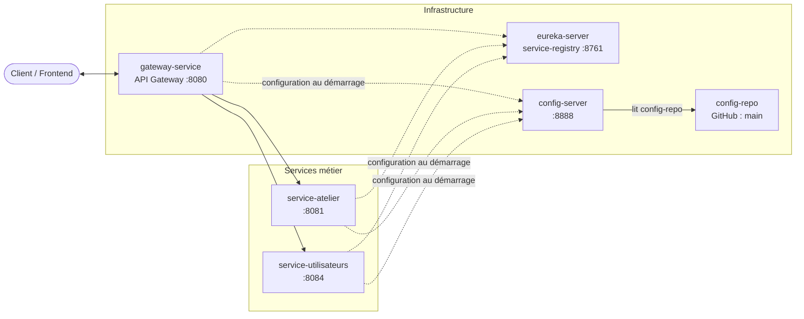
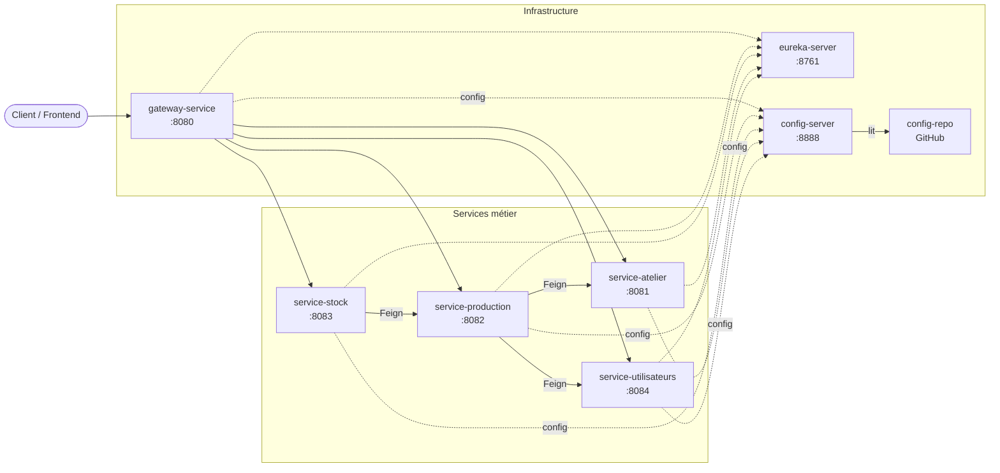
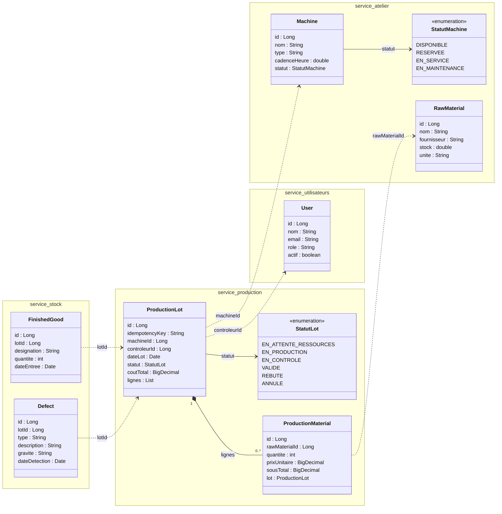
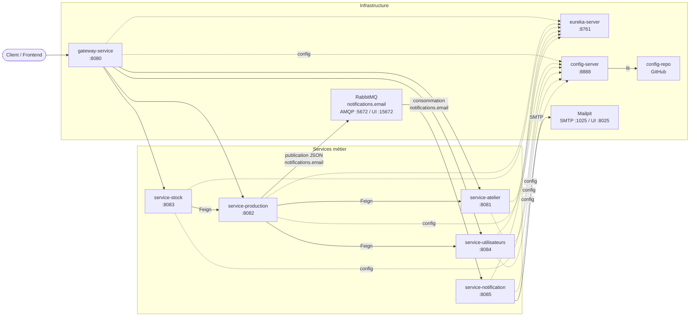
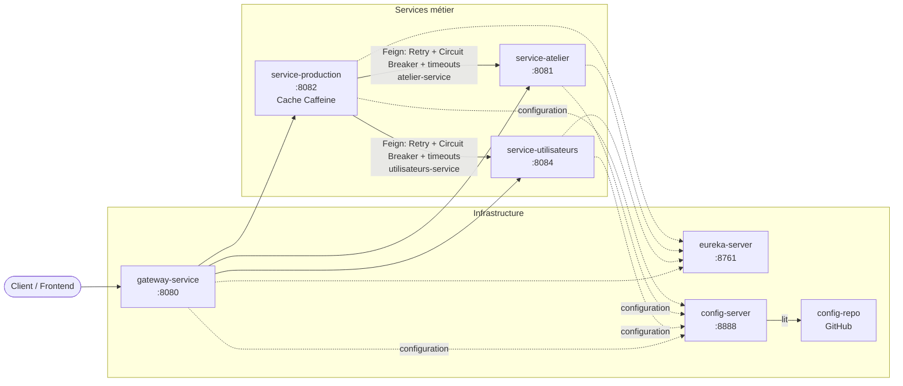

# Quali-Track

Application de **suivi de production en atelier**, construite en architecture microservices (Java 17, Spring Boot, Spring Cloud, Maven) dans le cadre du PFM de 5ème année (EMSI, cours J2EE avancé et Spring Boot).

Un **lot de production** est lancé sur une machine avec des matières premières, puis soumis à un contrôle qualité :

- **validé** : les produits conformes entrent en stock et la machine est libérée ;
- **rebuté** : les défauts sont enregistrés, et la machine est libérée ou placée en maintenance selon la cause du rejet ;
- **annulé** : si le lot n'a jamais démarré (ressources indisponibles), la machine et les matières réservées sont restituées.

Cycle de vie d'un lot : `EN_ATTENTE_RESSOURCES → EN_PRODUCTION → EN_CONTROLE → VALIDE / REBUTE`, ou `EN_ATTENTE_RESSOURCES → ANNULE`.

## Diagramme de classes

Chaque service possède ses propres entités. Les flèches en pointillés représentent les références entre services (par identifiant), sans préjuger du protocole de communication.



## Architecture

| Application | Rôle | Port |
|---|---|---|
| `gateway-service` | Point d'entrée unique, routage vers les services via Eureka | 8080 |
| `eureka-server` (`service-registry`) | Service Registry (découverte des services) | 8761 |
| `config-server` | Configuration centralisée depuis `config-repo` sur Git | 8888 |
| `service-atelier` | Machines et matières premières | 8081 |
| `service-utilisateurs` | Utilisateurs (contrôleurs qualité) | 8084 |



Flèches pleines : routage des requêtes par la Gateway, qui découvre les instances avec Eureka, et lecture de `config-repo` par le Config Server. Flèches en pointillés : enregistrement auprès d'Eureka et récupération de la configuration distante au démarrage.

## Lancer le projet

Depuis la racine du dépôt, démarrer les applications dans cet ordre, chacune dans un terminal séparé :

1. `mvn spring-boot:run -pl eureka-server`
2. `mvn spring-boot:run -pl config-server`
3. `mvn spring-boot:run -pl service-atelier`
4. `mvn spring-boot:run -pl service-utilisateurs`
5. `mvn spring-boot:run -pl gateway-service`

Le dashboard Eureka est disponible sur [http://localhost:8761](http://localhost:8761). Les services métier et la Gateway s'y enregistrent. La Gateway permet notamment d'appeler les services via la découverte :

- [http://localhost:8080/service-atelier/machines](http://localhost:8080/service-atelier/machines)
- [http://localhost:8080/service-utilisateurs/utilisateurs](http://localhost:8080/service-utilisateurs/utilisateurs)

Pour utiliser les routes statiques (`/machines/**`, `/matieres-premieres/**` et `/utilisateurs/**`) au lieu du préfixe de découverte, démarrer la Gateway avec le profil `statique` :

```shell
mvn spring-boot:run -pl gateway-service "-Dspring-boot.run.profiles=statique"
```

## Jalon V3 — Config Server

Le dossier `config-repo/` contient les propriétés globales partagées dans `application.properties` et les propriétés spécifiques à chaque service dans un fichier nommé d'après son application. Le fichier `gateway-service-statique.properties` contient la configuration des routes du profil `statique`.

Ordre de démarrage : Eureka (8761) → Config Server (8888) → `service-atelier` (8081) / `service-utilisateurs` (8084) → Gateway (8080). Le Config Server doit être démarré après Eureka, et avant les services et la Gateway, car ces trois clients récupèrent leur configuration distante au démarrage et échouent si le Config Server n'est pas disponible.

Eureka et Config Server conservent leur configuration localement : le Config Server est nécessaire pour fournir les configurations distantes, et Eureka doit démarrer indépendamment de ce serveur pour éviter une dépendance d'amorçage.

Avant de lancer le Config Server, `config-repo/` doit être commité et poussé sur la branche `main` de GitHub. Le serveur lit le dépôt GitHub configuré, pas le dossier local du dépôt.

URL de vérification des configurations :

- [http://localhost:8888/service-atelier/default](http://localhost:8888/service-atelier/default) — 2 `propertySources` : `service-atelier.properties`, puis `application.properties`.
- [http://localhost:8888/service-utilisateurs/default](http://localhost:8888/service-utilisateurs/default)
- [http://localhost:8888/gateway-service/default](http://localhost:8888/gateway-service/default)

Avec le discovery locator activé, la route Gateway vers les machines est [http://localhost:8080/service-atelier/machines](http://localhost:8080/service-atelier/machines). La route [http://localhost:8080/machines](http://localhost:8080/machines) correspond à la route statique, disponible avec le profil `statique`.

## V4 - Communication synchrone avec OpenFeign

### Objectif

Le jalon V4 met en place la communication synchronisée entre `service-production` et les services externes via OpenFeign. La création d'un lot passe par plusieurs validations métier avant la réservation de la machine et la consommation de stock : vérification du contrôleur, disponibilité de la machine, existence de la matière et stock suffisant, puis réservation machine + décrément stock dans `service-atelier`.

### Services impliqués

- `service-production` (8082) : orchestration du lot, validation des transitions et enrichissement des détails.
- `service-atelier` (8081) : machines et matières premières, réservation et décrément de stock.
- `service-utilisateurs` (8084) : profils utilisateurs et rôle `CONTROLEUR_QUALITE`.
- `service-stock` (8083) : création de `FinishedGood` et `Defect` selon le statut du lot.
- `gateway-service` (8080) : point d'entrée unique pour les appels de test via la collection Postman.
- `eureka-server` (8761) : découverte des services.
- `config-server` (8888) : configuration partagée.

### Règles métier

- Création contrôlée d'un lot : `POST /service-production/lots/new` avec en-tête `idempotencyKey` obligatoire et unique.
- Vérifications métier avant réservation : machine existante et `DISPONIBLE`, contrôleur actif avec rôle `CONTROLEUR_QUALITE`, matière existante et stock suffisant.
- Réservation de la machine et décrément de stock dans `service-atelier` exécutés dans une même création de lot ; si l'une des validations échoue, la transaction est interrompue avant réservation.
- Consultation enrichie : `GET /service-production/lots/{id}/detail` ajoute `machineNom`, `controleurNom`, `controleurEmail` et `rawMaterialNom` sur chaque ligne.
- Consultation enrichie : `GET /service-stock/finished-goods/{id}/detail` renvoie le statut du lot associé et les informations de stockage.
- Règle de création de `FinishedGood` : le lot associé doit être `VALIDE`.
- Règle de création de `Defect` : le lot associé doit être `EN_CONTROLE` ou `REBUTE`.
- Les transitions de statut validées par `ProductionLotService` sont : `EN_ATTENTE_RESSOURCES -> EN_PRODUCTION | ANNULE`, `EN_PRODUCTION -> EN_CONTROLE | ANNULE`, `EN_CONTROLE -> VALIDE | REBUTE`.

### Tableau des erreurs

| Code HTTP | Cause | Message observé |
|---|---|---|
| 400 | Validation métier ou payload invalide | `Contrôleur invalide`, `Machine indisponible`, `Stock insuffisant ...`, `Clé d’idempotence invalide`, `Opération déjà traitée` |
| 404 | Ressource absente ou service distant introuvable | `Ressource externe introuvable`, `ProductionLot not found: ...` |
| 409 | Conflit de données persistées | `A resource with conflicting data already exists` |
| 502 | Réponse HTTP non satisfaisante d'un service distant | `Erreur HTTP du service distant : [xxx]` |
| 503 | Service indisponible ou instance inaccessible | `Échec de communication avec un service` ou `Service ou instance indisponible` |

### Limite connue

La réservation de la machine et le décrément de stock sont traités en deux étapes séquentielles au sein de la création du lot. S'il y a un échec de la réservation après la première étape de validation, il n'y a pas de compensation automatique ; cette limite est traitée en V7 avec Kafka et transaction distribuée.

### Comment lancer la collection Postman

1. Importer le fichier `postman/Quali-Track - V4 OpenFeign.postman_collection.json` dans Postman.
2. Vérifier que les variables de collection sont bien définies : `baseUrl=http://localhost:8080`, `machineId=1`, `controleurId=3`, `adminId=1`, `rawMaterialId=1`, `lotKey`, `lotId`, `finishedGoodId`.
3. Démarrer les services dans l'ordre habituel : Eureka, Config Server, `service-atelier`, `service-utilisateurs`, `service-production`, `service-stock`, Gateway.
4. Exécuter la séquence dans l'ordre des requêtes du dossier `V4 - OpenFeign` ; la requête 6 réserve la machine et décrémente le stock de `rawMaterialId`.
5. Les données sont rechargées par le script `data.sql` au démarrage des services en mémoire. À chaque relance, redémarrer `service-atelier` (et `service-production` / `service-stock` si leurs données sont aussi en mémoire) pour repartir sur un seed propre.
6. Le dossier `Manuel - service indisponible` doit être exécuté manuellement, après arrêt de `service-atelier`, et exclu d'un run complet du Runner.

### Architecture V4



Flèches pleines : routage des requêtes via la Gateway. Flèches pointillées : découverte Eureka et lecture de configuration. Flèches Feign : `service-production` appelle `service-atelier` et `service-utilisateurs`; `service-stock` appelle `service-production` pour vérifier le statut des lots.

### Diagramme de classes V4



La description détaillée de la collection Postman V4 est dans le dossier `postman/Quali-Track - V4 OpenFeign.postman_collection.json`.

## V5 - Communication asynchrone (RabbitMQ + notification email)

### Objectif

Le jalon V5 ajoute une communication asynchrone après la création réussie d'un lot. `service-production` publie un `NotificationEmailDto` dans la file durable `notifications.email` après validation des réservations et commit de la transaction. `service-notification` consume le message, valide ses champs et transmet l'email à Mailpit.

### Architecture V5



Flèches pleines : routage HTTP via la Gateway ou échanges métier/Email. Flèches pointillées : découverte Eureka et lecture de configuration. `service-notification` est enregistré dans Eureka et lit le Config Server, mais n'est pas exposé par la Gateway. La file durable utilisée est `notifications.email` dans l'exchange AMQP par défaut de RabbitMQ.

### RabbitMQ et Mailpit avec Docker

```shell
docker run -d --name mailpit -p 127.0.0.1:1025:1025 -p 127.0.0.1:8025:8025 axllent/mailpit
docker run -d --name rabbitmq -p 127.0.0.1:5672:5672 -p 127.0.0.1:15672:15672 -e RABBITMQ_DEFAULT_USER=tp -e RABBITMQ_DEFAULT_PASS=tp123 -v tp-rabbitmq-data:/var/lib/rabbitmq rabbitmq:4-management
```

Pour relancer les conteneurs :

```shell
docker start rabbitmq
docker start mailpit
```

Pour simuler une panne :

```shell
docker stop rabbitmq
docker stop mailpit
```

Interfaces disponibles :

- RabbitMQ : [http://localhost:15672](http://localhost:15672) — utilisateur `tp`, mot de passe `tp123`
- Mailpit : [http://localhost:8025](http://localhost:8025)

Avant le démarrage, les fichiers `config-repo/service-notification.properties` et `config-repo/service-production.properties` doivent être commités et poussés sur la branche `main`, car le Config Server lit le dépôt GitHub configuré et non le dossier local.

### Ordre de démarrage

1. Docker : RabbitMQ et Mailpit.
2. `mvn spring-boot:run -pl config-server`
3. `mvn spring-boot:run -pl eureka-server`
4. `mvn spring-boot:run -pl service-atelier`
5. `mvn spring-boot:run -pl service-utilisateurs`
6. `mvn spring-boot:run -pl service-production`
7. `mvn spring-boot:run -pl service-stock`
8. `mvn spring-boot:run -pl service-notification`
9. `mvn spring-boot:run -pl gateway-service`

### Déclenchement de la notification

La création réussie d'un lot déclenche la notification :

```http
POST {{baseUrl}}/service-production/lots/new
Content-Type: application/json
idempotencyKey: <clé unique>

{
  "machineId": {{machineId}},
  "controleurId": 3,
  "lignes": [{"rawMaterialId": 1, "quantite": 1}]
}
```

Le destinataire est l'email du contrôleur qualité actif utilisé pour le lot. La publication est effectuée après commit de la transaction.

### Comportements attendus

- Une création avec succès retourne `201`, même si RabbitMQ est arrêté : l'erreur RabbitMQ est seulement loguée par `service-production`.
- Un message invalide reçu par `service-notification` fait 3 tentatives, puis est rejeté sans remise en file.
- Rejouer exactement la même `idempotencyKey` retourne `400` avec `Opération déjà traitée` et ne publie aucun email.
- `POST http://localhost:8085/notifications/email` retourne `204` pour un payload valide, `400` pour une validation invalide et `503` si Mailpit ou le serveur SMTP est indisponible.

### Scénario de traitement différé

1. Arrêter `service-notification`.
2. Créer plusieurs lots avec des clés d'idempotence uniques ; chaque création retourne `201`.
3. Ouvrir RabbitMQ Management : la file `notifications.email` doit apparaître avec le compteur **Ready** qui augmente.
4. Redémarrer `service-notification`.
5. Le consommateur traite les messages différés : les emails apparaissent dans Mailpit. Les compteurs **Ready** et **Unacked** de `notifications.email` doivent revenir à `0`.

La description détaillée des tests V5 se trouve dans `postman/Quali-Track - V5 Notification RabbitMQ.postman_collection.json`.

## V6 - Résilience

### Objectif

Le jalon V6 protège les lectures de `service-production` vers `service-atelier` et `service-utilisateurs` avec Retry, Circuit Breaker, timeouts OpenFeign et cache Caffeine. Il distingue les consultations tolérantes des créations strictes afin d'éviter les réservations ou décréments involontaires.

### Services et protection

- `service-production` (`8082`) : appels de lecture protégés vers les machines, matières premières et utilisateurs.
- `service-atelier` (`8081`) : instance Resilience4j `atelier-service`, utilisée pour les machines et matières premières.
- `service-utilisateurs` (`8084`) : instance Resilience4j `utilisateurs-service`.
- `cache Caffeine` dans `service-production` : caches `machines`, `rawMaterials` et `utilisateurs`, expiration après écriture de 10 minutes, taille maximale 1000.

Les appels protégés concernent uniquement les lectures Feign :

- création du lot : lecture machine, contrôleur et matières avec le repli strict ; une panne ou un circuit ouvert retourne `503` avec `ServiceExterneIndisponibleException`.
- détail enrichi du lot : lecture machine, contrôleur et matières avec le repli tolérant ; le cache est utilisé, puis un DTO minimal peut être retourné pour préserver la consultation.
- les erreurs métier normales ne sont pas transformées en `503` : `404` pour une machine ou matière inexistante, `400` pour stock insuffisant ou validation métier.

La réservation machine `atelierClient.reserveMachine(...)` et le décrément stock `rawMaterialClient.decrementStock(...)` restent des appels Feign directs sans Retry ni Circuit Breaker. Cette séparation évite qu'un repli ou une répétition automatique puisse produire un double effet sur une écriture.

### Paramètres appliqués

- Timeouts OpenFeign : connexion `1000 ms`, lecture `2000 ms`.
- Ordre des aspects : Retry `1`, Circuit Breaker `2`.
- Retry `atelier-service` : 3 tentatives au maximum, attente 500 ms.
- Retry `utilisateurs-service` : 3 tentatives au maximum, attente 500 ms.
- Exceptions Retry : `feign.RetryableException` et `feign.FeignException$ServiceUnavailable`.
- Circuit Breaker : fenêtre comptée de 6 appels, minimum 4 appels, seuil d'échec 50 %, passage automatique en HALF_OPEN activé, 3 appels autorisés en HALF_OPEN.
- Temps d'ouverture : `10 s` pour `atelier-service`, `5 s` pour `utilisateurs-service`.
- Aucun Bulkhead ni RateLimiter n'est configuré.

Le serveur de configuration lit `config-repo/service-production.properties` depuis GitHub. Toute modification de ce fichier doit donc être **committée puis poussée** sur la branche `main` avant de redémarrer ou de recharger les services concernés.

### Architecture V6



Flèches pleines : routage HTTP et appels Feign. Flèches Feign vers `service-atelier` et `service-utilisateurs` : Retry, Circuit Breaker et timeouts activés. `service-production` contient les caches Caffeine `machines`, `rawMaterials` et `utilisateurs`. Flèches pointillées : découverte Eureka et récupération de configuration.

### Scripts de démonstration

Depuis la racine du dépôt :

```powershell
.\scripts\v6\01-normal.ps1
.\scripts\v6\02-service-indisponible.ps1
.\scripts\v6\03-reprise.ps1
.\scripts\v6\04-rejeu-idempotence.ps1
.\scripts\v6\05-erreurs-metier.ps1
```

Les scripts cherchent eux-mêmes une machine avec `DISPONIBLE` via `GET http://localhost:8081/machines` et affichent le statut HTTP, le temps de réponse et le corps de chaque appel.

#### 01-normal.ps1

- Recherche une machine disponible.
- Génère une `idempotencyKey` avec `[guid]::NewGuid()`.
- Crée un lot avec `POST http://localhost:8082/lots/new` et attend `201`.
- Appelle `GET http://localhost:8082/lots/{id}/detail` et attend `200`.
- Résultat attendu : les champs `machineNom`, `controleurNom` et `controleurEmail` sont renseignés.

#### 02-service-indisponible.ps1

- Recherche et mémorise une machine disponible avant l'arrêt.
- Demande d'arrêter `service-atelier`.
- Appelle le détail du lot configuré par le paramètre `LotId`, dont la valeur par défaut est `1`, avec `GET /lots/{LotId}/detail`.
- Résultat attendu : `200` depuis le cache ou avec des valeurs d'enrichissement tolérantes ; les retries peuvent rendre la réponse lente.
- Lance 6 créations avec des clés uniques.
- Les premières peuvent être lentes avec `503` ; les suivantes deviennent quasi instantanées après ouverture du circuit.

#### 03-reprise.ps1

- Demande de relancer `service-atelier` et d'attendre son réenregistrement Eureka.
- Vérifie si une machine disponible existe. Après redémarrage d'une base H2 en mémoire, une machine peut avoir été perdue ; le script demande alors d'en créer une avec `POST http://localhost:8081/machines`.
- Boucle jusqu'à 8 essais, à 10 secondes d'intervalle, avec une `idempotencyKey` unique à chaque création.
- Résultat attendu : les essais initiaux peuvent retourner `503` pendant HALF_OPEN ou pendant l'attente Eureka, puis une création retourne `201`.

#### 04-rejeu-idempotence.ps1

- Compte les lots avant création.
- Création avec la clé fixe `v6-idempotence-fixed` : attendu `201`.
- Rejoue exactement la même requête deux fois avec la même clé : attendu `400` et message `Opération déjà traitée`.
- Compte les lots après : attendu un seul lot ajouté par rapport au compte initial.

#### 05-erreurs-metier.ps1

- Machine inexistante : attendu `404`, avec `Ressource externe introuvable` ou erreur Feign correspondante.
- Matière inexistante : attendu `404`, avec `Ressource externe introuvable` ou erreur Feign correspondante.
- Stock insuffisant : attendu `400` avec `Stock insuffisant pour la matière ...`.
- Résultat attendu : ces cas restent des erreurs métier propagées, pas des `503` causés par la résilience.

### Idempotence

La création utilise le endpoint réel `POST /lots/new` avec l'en-tête obligatoire `idempotencyKey`.

```http
POST http://localhost:8082/lots/new
idempotencyKey: <clé unique>
Content-Type: application/json

{
  "machineId": <machine DISPONIBLE>,
  "controleurId": 3,
  "lignes": [{"rawMaterialId": 1, "quantite": 1}]
}
```

La vérification de l'idempotence précède toute validation distante et toute réservation. Rejouer une clé déjà enregistrée retourne `400` avec `Opération déjà traitée` sans créer de doublon.

