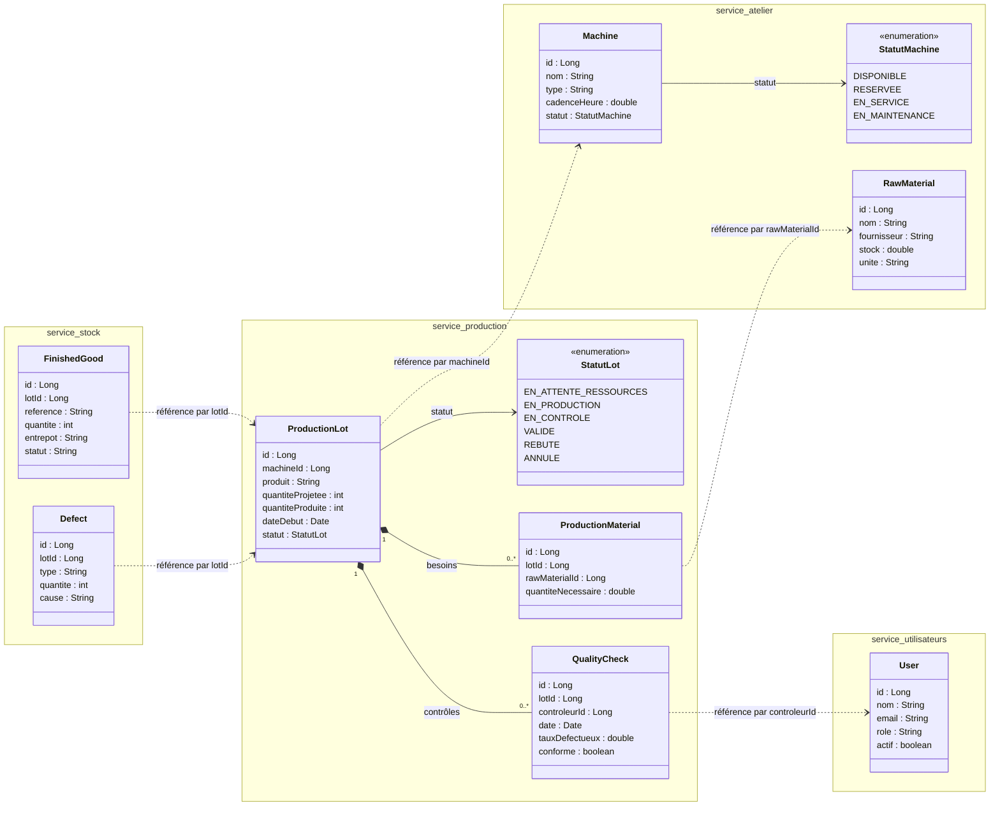
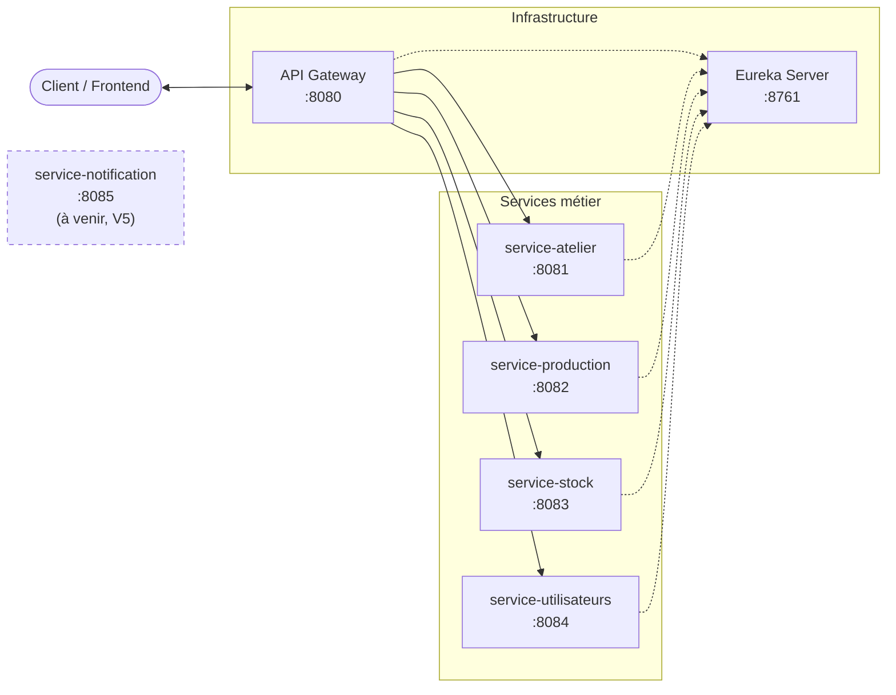

# Quali-Track

Application de **suivi de production en atelier**, construite en architecture microservices (Java 17, Spring Boot, Spring Cloud, Maven) dans le cadre du PFM de 5ème année (EMSI, cours J2EE avancé et Spring Boot).

Un **lot de production** est lancé sur une machine avec des matières premières, puis soumis à un contrôle qualité :

- **validé** : les produits conformes entrent en stock et la machine est libérée ;
- **rebuté** : les défauts sont enregistrés, et la machine est libérée ou placée en maintenance selon la cause du rejet ;
- **annulé** : si le lot n'a jamais démarré (ressources indisponibles), la machine et les matières réservées sont restituées.

Cycle de vie d'un lot : `EN_ATTENTE_RESSOURCES → EN_PRODUCTION → EN_CONTROLE → VALIDE / REBUTE`, ou `EN_ATTENTE_RESSOURCES → ANNULE`.

## Diagramme de classes

Chaque service possède ses propres entités. Les flèches en pointillés représentent les références entre services (par identifiant), sans préjuger du protocole de communication.

## Architecture

| Application | Rôle | Port |
|---|---|---|
| `api-gateway` | Point d'entrée unique, routage vers les services | 8080 |
| `eureka-server` | Service Registry (découverte des services) | 8761 |
| `service-atelier` | Machines et matières premières | 8081 |
| `service-production` | Lots de production, contrôles qualité (service principal) | 8082 |
| `service-stock` | Produits finis et défauts | 8083 |
| `service-utilisateurs` | Utilisateurs (contrôleurs qualité) | 8084 |
| `service-notification` | Notifications au responsable de production *(à venir, jalon V5)* | 8085 |

Flèches pleines : routage des requêtes via la Gateway. Flèches en pointillés : enregistrement et découverte via Eureka.
